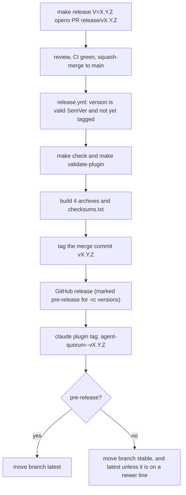

# Contributing to agent-quorum

Thanks for helping. This file covers the dev loop, the rules the code lives by, and how releases are versioned and cut. For what the tool does, read [README.md](README.md).

## Prerequisites

- Go 1.27
- `jq` (used by `make lint`, `make release` and the version stamp)
- the `gh` CLI, for `make release` to open the release pull request
- `shellcheck` (optional locally, enforced in CI)
- `golangci-lint` v2 (optional locally, enforced in CI; config in `.golangci.yml`)
- the `claude` CLI, for `make validate-plugin` and for trying the plugin by hand
- the `codex` CLI, for installing and checking the Codex marketplace package locally
- the `agy` CLI, for validating the Antigravity plugin (`make validate-antigravity-plugin`)
- `bun` (optional locally): `make lint` parse-checks the OpenCode plugin with it; the `opencode` CLI for trying that plugin by hand
- `git`, `curl`, `tar`
- macOS or Linux

## Dev loop

```bash
make check      # vet + lint + test: what CI runs, minus golangci-lint
golangci-lint run  # the CI golangci job (v2.15.0)
make dev        # build, then start Claude Code with the local plugin and local binary
```

Every make target:

| Target | What it does |
|---|---|
| `make build` | Builds `./bin/agent-quorum`, version stamped as `<plugin.json version>-dev`. |
| `make test` | `go test -race -count=1 ./...` |
| `make vet` | `go vet ./...` plus a gofmt check that fails on unformatted files. |
| `make lint` | `sh -n` and shellcheck on `plugin/scripts/*.sh` and `scripts/*.sh`, `jq empty` on the marketplace, plugin and hooks JSON, and a `bun build --no-bundle` parse check of `plugin/opencode/index.ts` (skipped without `bun`). |
| `make check` | `vet`, `lint`, `test`. |
| `make validate-plugin` | Validates the Claude plugin and marketplace, then discovers and installs the Codex plugin in a temporary `CODEX_HOME`. Needs the `claude`, `codex` and `jq` CLIs. |
| `make validate-antigravity-plugin` | Runs `agy plugin validate ./plugin`. Needs the Antigravity CLI (`agy`); Antigravity reports the separate Claude hook config as an expected ignored-file warning. |
| `make snapshot` | Cross-compiles the four release archives (darwin and linux, amd64 and arm64) and `checksums.txt` into `./dist`. |
| `make dev` | `make build`, then `AGENT_QUORUM_BIN=$PWD/bin/agent-quorum claude --plugin-dir ./plugin`. |
| `make release V=1.2.3` | Runs `make check`, then `scripts/bump-version.sh`: creates `release/v1.2.3`, sets the version in `plugin.json`, commits, pushes and opens the release pull request. Merging it publishes the release. |
| `make clean` | Removes `bin` and `dist`. |

Run one test:

```bash
go test -race -run TestHookFailsOpen ./cmd/agent-quorum
```

Run a hook by hand, with no agent involved:

```bash
./bin/agent-quorum hook --agent claude < testdata/hooks/claude/pre_edit.json; echo $?
```

Capture real hook payloads from your Claude Code version with `AGENT_QUORUM_CAPTURE=/tmp/cap.jsonl make dev`, then `jq -c .payload /tmp/cap.jsonl`. Debug hooks in a live session with `claude --debug-file /tmp/cc.log` and search for lines starting `Hooks:`; apply `hooks.json` edits with `/reload-plugins`.

Use a scratch runtime directory when experimenting so you do not disturb your real daemon: `export AGENT_QUORUM_HOME=$(mktemp -d)`.

## Project layout

```text
cmd/agent-quorum/           argument dispatch (main.go), hook entry (hook.go), CLI commands (cli.go)
internal/proto/             Request, Response, Version: the neutral wire protocol
internal/core/              State, Session, Claim, decisions and the deny/context texts. Pure.
internal/guard/             Classify(command) Risk. Pure.
internal/adapter/claude/    Parse and Render for Claude Code hook JSON. Pure.
internal/adapter/codex/     Parse and Render for Codex hook JSON. Pure.
internal/adapter/antigravity/ Parse and Render for Antigravity hook JSON. Pure.
internal/adapter/opencode/  Parse and Render for the OpenCode plugin's bridge events. Pure.
internal/daemon/            socket server, flock, snapshot, the real core.Env
internal/client/            dial, start-on-demand, deadlines, path normalisation
internal/gitx/              thin wrappers over the git CLI
plugin/                     Claude Code, Codex and Antigravity manifests, hooks, scripts/*.sh, skills/status
plugin/opencode/index.ts    OpenCode plugin: a thin TypeScript shim that forwards bridge events to `hook --agent opencode`
scripts/                    release-build.sh, bump-version.sh
testdata/hooks/claude/      Claude Code hook payload fixtures
testdata/hooks/antigravity/ Antigravity hook payload fixtures
testdata/hooks/opencode/    OpenCode bridge-event fixtures
.claude-plugin/             marketplace.json: the repo root is a marketplace for Claude Code and Codex
```

### Invariants

Do not break these. Review will check each one.

1. **Fail open, always.** Any error, panic, timeout, missing binary or missing daemon in the hook path means exit 0 with empty stdout. A broken agent-quorum must be invisible. Do not set `onFailure` in `hooks.json`.
2. **Never emit `permissionDecision: "allow"`.** A grant is empty output. `allow` would bypass the user's permission prompts. A deny is exit 0 with the `hookSpecificOutput` deny JSON on one line.
3. **Deny reasons are written for the model**, as instructions: who holds the file, what not to do (including shell workarounds), what to do instead.
4. **`core`, `guard` and `adapter/*` are pure.** No OS imports and no `time.Now()`. Everything impure is injected through `core.Env` (`Now`, `Alive`, `Dirty`, `RepoRoot`). `State.Handle(req)` is the only entry point into core.
5. **Neutral core, adapters at the edge.** The daemon never sees agent-specific JSON. Supporting another agent is an adapter (two pure functions, golden-file tested) plus a hook config, with no core changes.
6. **Release by evidence, validated lazily.** No reaper, timers or background goroutines. Claim validity is checked only at contention or status time.
7. **Exec all the way down.** Hooks use exec form (`args` present) and the launcher uses `exec`, so `getppid()` in the binary is the agent process. Liveness detection depends on that; never insert a shell in between.
8. **Nothing derives paths from Claude's config dir, `CLAUDE_PLUGIN_ROOT` or `CLAUDE_PLUGIN_DATA`.** Sessions with different config dirs must reach the same daemon.
9. **Plugin scripts depend on nothing but POSIX tools.** No `jq` at runtime on a user's machine; `plugin.json` is read with `sed`.

## Code style

- **Go:** follow the [Google Go Style Guide](https://google.github.io/styleguide/go/) strictly, including its decisions and best-practices documents. `gofmt` is enforced by `make vet`.
- **JSON:** use `github.com/bytedance/sonic`. Do not reach for `encoding/json` in new code.
- **Generic helpers:** use `github.com/bytedance/gg` rather than hand-rolled helpers for maps, slices and options.
- **Shell:** POSIX `sh`, no bashisms, passing `shellcheck`. Plugin scripts must fail open and stay cheap, since the launcher runs on every hook call.
- **Comments and docs:** plain prose, no emojis.

## Testing expectations

- Table-driven tests with a fake `core.Env`. Core logic is tested without a daemon, a clock or git.
- Adapter tests cover payload parsing and rendering. Add fixtures under `testdata/hooks/<agent>/` for payloads worth preserving; when an agent changes its payload, capture it from a real run instead of guessing.
- **Every new failure path in the hook gets a fail-open test** proving the result is exit 0 with empty stdout. `TestHookFailsOpen` in `cmd/agent-quorum` is the model.
- Run everything with `-race` (`make test` does). Concurrency tests, such as many goroutines claiming one path with exactly one grant, belong in the package that owns the lock.
- A new guard rule needs a table row for the case it blocks and one for the near-miss it must allow.
- Changes to deny or context text need a test on the text, since the model is the reader.

## Branches and pull requests

`main` is protected. Nothing is pushed to it directly, including releases: every change lands through a pull request.

1. **Branch from an up-to-date `main`.** Name it for the change: `feat/...`, `fix/...`, `docs/...`, `ci/...`. Release branches are `release/vX.Y.Z` and are created by `make release`.
2. **Commit** with short imperative subjects, one logical change per commit: `fix: allow git stash list`, `feat: add status --json`.
3. **Run `make check` locally**, and `make validate-plugin` if you touched `plugin/` or the marketplace manifest.
4. **Open a pull request against `main`.** Describe the behaviour change and how you tested it. Call out any change to a public surface (see [Versioning](#versioning)), because it decides the next version bump.
5. **CI must be green** (`test` on Ubuntu and macOS, `golangci`, `lint`, `plugin`) and the pull request needs an approving review before it can merge.
6. **Squash-merge**, then delete the branch. The squash subject becomes the line in the generated release notes, so make it read well.

Rules:

- Do not edit the version in `plugin/.claude-plugin/plugin.json`, `plugin/.codex-plugin/plugin.json`, `plugin/.antigravity-plugin/plugin.json`, or `mod/.claude-plugin/plugin.json` in an ordinary pull request. `make release` updates all four manifests together; a version change on `main` publishes a release.
- Do not commit to `stable` or `latest`. They are channel branches moved by the release workflow.
- Do not force-push `main` or rewrite published tags.

## Versioning

agent-quorum follows [Semantic Versioning 2.0.0](https://semver.org/spec/v2.0.0.html). Versions have the form `MAJOR.MINOR.PATCH` with an optional pre-release suffix.

### What is the public API

Semantic Versioning needs a declared public API. For this project it is everything a user, an agent or another tool can observe or depend on:

1. **Hook behaviour that agents observe.** Which events and tools are hooked, when an edit or command is denied or granted, that a grant is silent, and the shape of the deny JSON. The wording of deny and context texts is not part of the API; their meaning is.
2. **The CLI.** Commands, flags, arguments, exit codes, and the output of `status --json`. Human-readable output of `status` is not a stable interface; use `--json`.
3. **The wire protocol.** The request and response fields and ops, and the protocol version `v` (`proto.Version`).
4. **The `state.json` format**, because a new binary must be able to reload a snapshot written by an older one.
5. **Environment variables** (`AGENT_QUORUM_*`) and their meanings, and the layout of `~/.agent-quorum`.
6. **The plugin manifest and layout**: plugin name, marketplace name (`agent-quorum-tools`), hook registrations in `hooks.json`, the skill name, and the release asset naming contract (`agent-quorum_<version>_<os>_<arch>.tar.gz` plus `checksums.txt`).

Go packages under `internal/` are not public API.

### MAJOR, MINOR, PATCH

**MAJOR** for an incompatible change to the public API:

- A command, flag, environment variable or `status --json` field is removed or changes meaning (for example, removing `release --all`).
- The `state.json` format changes so that an older snapshot can no longer be loaded.
- The wire protocol `v` is bumped for an incompatible change.
- A hook that was granting now denies by default, or the guard starts blocking a command class that was previously allowed in the same situations, in a way that breaks existing workflows (for example, denying `git push`).
- Dropping a supported platform or agent, or renaming the plugin or marketplace.

**MINOR** for backward-compatible additions and notable behaviour:

- A new CLI command or flag (the way `install-git-hook` was added), a new `status --json` field, a new environment variable.
- A new hook event or matcher, or a new adapter such as Codex.
- A new guard verb that blocks only a clearly destructive command, when documented in the changelog.
- A new optional wire-protocol field or op that older clients may ignore.
- Deprecating something (removal waits for the next MAJOR).

**PATCH** for fixes that keep the documented behaviour:

- A guard misclassification fixed in the direction of the documented rules (for example, `git stash list` wrongly denied).
- A fail-open hole closed, a race fixed, a deny message reworded, a crash or timeout fixed.
- Install-script and launcher fixes, documentation and test-only changes, dependency bumps with no behaviour change.

When in doubt, ask who would be surprised. If a user's existing script, hook config or habit would break, it is MAJOR (or MINOR before 1.0, see below).

### Before 1.0 (0.y.z)

While the version is `0.y.z`, anything may change at any time under the Semantic Versioning spec. This project adds two rules of its own:

- A change that would be MAJOR after 1.0 bumps `y` (for example, 0.3.0 to 0.4.0) and is called out under "Breaking" in the changelog.
- A change that would be MINOR or PATCH after 1.0 bumps `z`, except that notable new features may bump `y`.

Version 1.0.0 will be declared once the Claude Code hooks, the CLI and the wire protocol have been stable across a few releases and real use.

### Pre-release tags

A pre-release such as `v0.2.0-rc.1` precedes `v0.2.0` in precedence and means "candidate, may still change". Use `-rc.N` for release candidates.

- `make release V=0.2.0-rc.1` opens a release pull request exactly as for a stable version. `scripts/semver.sh` validates the version strictly (it rejects `1.2`, `v1.2.3`, `1.2.3.4` and leading zeros).
- When that pull request merges, the release workflow publishes a GitHub **pre-release** and moves only the `latest` channel. Users on `stable` are not affected.
- Release assets carry the full version: `agent-quorum_0.2.0-rc.1_linux_amd64.tar.gz`.
- `main` carries the candidate's version until the stable release merges. `main` is not a channel; users should add the marketplace with `#stable` or `#latest`.

### Where the version lives

- `plugin/.claude-plugin/plugin.json` `version` is the source of truth; `plugin/.codex-plugin/plugin.json`, `plugin/.antigravity-plugin/plugin.json` and `mod/.claude-plugin/plugin.json` mirror it. Only a release pull request, opened by `make release`, edits these fields.
- The git tag is `v<version>`, annotated, created by the release workflow on the merge commit. Nobody tags by hand in the normal flow.
- Binaries are stamped at build time with `-ldflags "-X main.version=<version>"`. `scripts/release-build.sh` stamps the exact version; `make build` stamps `<version>-dev`. An unstamped `go build` reports `dev`.
- Claude Code users stay on their cached copy of a plugin until the `version` string changes, so a release is a version bump or it is nothing.
- The **wire protocol version `v` is independent of the product version.** It changes only for an incompatible protocol change, which is also a MAJOR change of the product. Many product releases share `v: 1`.
- **Mixed versions.** Two sessions running different plugin versions share one daemon: whichever hook started it determines the daemon's version. A new hook binary talking to an old daemon works as long as `v` matches, and new behaviour in the daemon appears only after `agent-quorum stop` and a restart. Keep MINOR and PATCH releases compatible with a running older daemon and with a `state.json` written by it.

## CI/CD

Two workflows in `.github/workflows/`.

**`ci.yml`** runs on every pull request and on pushes to `main`:

| Job | What it checks |
|---|---|
| `test` (Ubuntu and macOS) | `make vet`, `make test` (race detector), `make build` |
| `golangci` | `golangci-lint run` (v2.15.0) with `.golangci.yml`: the standard linters plus `revive`, golint's successor |
| `lint` | `make lint` (shellcheck, `sh -n`, JSON syntax), and that the launcher fails open when no binary exists |
| `plugin` | `make validate-plugin`: validates the Claude plugin and marketplace, then installs the Codex plugin in a temporary Codex home |

**`release.yml`** publishes a release. It runs when a push to `main` changes `plugin/.claude-plugin/plugin.json`, which in practice means when a release pull request is merged. If the version in the manifest has no tag yet, it tags the merge commit and publishes; if the tag already exists it does nothing. Releases are serialised and never cancelled halfway. (Pushing a `v*` tag by hand also triggers it, as a fallback.)



### Marketplace channels

Claude Code has no release-channel concept: one marketplace ref serves one version of a plugin, and a user gets an update only when the plugin's `version` changes. Channels are therefore two branches of this repository that the release workflow moves, and a user picks one when adding the marketplace:

```bash
claude plugin marketplace add ChristopherLiew/agent-quorum#stable   # stable releases only
claude plugin marketplace add ChristopherLiew/agent-quorum#latest   # release candidates too
```

| Branch | Moves when | Who should use it |
|---|---|---|
| `stable` | a release without a pre-release suffix is published | everyone by default |
| `latest` | any pre-release is published; also on a stable release, unless `latest` is already on a newer `MAJOR.MINOR.PATCH` line | people testing release candidates |
| `main` | on every merge | contributors; not a channel |

Rules that follow from this:

- Never commit to `stable` or `latest` by hand. `scripts/publish-channels.sh` force-moves them to a released commit, and only after the binaries are published, so a channel never advertises a version whose download would fail.
- `version` is set only in `plugin.json`, never also in the marketplace entry. Claude Code uses the manifest value and `claude plugin validate` reports a mismatch.
- A channel moving without a version change does nothing for users, who stay on their cached copy. Every release is a version bump.
- Both channels share the marketplace name `agent-quorum-tools`, so a user is on one channel at a time. To switch, remove the marketplace and add it again with the other suffix.
- Third-party marketplaces do not auto-update by default. Users enable it under `/plugin`, or run `claude plugin update agent-quorum@agent-quorum-tools`.
- The `agent-quorum--v<version>` tag created by `claude plugin tag` is the convention that lets other plugins depend on a version range of this one. It checks that the manifest and marketplace entry agree and that the tree is clean.

To rehearse the channel moves without pushing: `DRY_RUN=1 scripts/publish-channels.sh 0.2.0-rc.1 "$(git rev-parse HEAD)"`.

## Release SOP

Run this before every tag. Do not skip steps because the change is small.

1. **Start from a clean, up-to-date `main` with CI green.** `git status` is clean, `git pull` is done, and the latest CI run on that commit passed on Ubuntu and macOS.
2. **Decide the version** (`x.y.z`, or `x.y.z-rc.N` for a candidate) from the versioning rules above, by reading the changes since the last tag (`git log <last-tag>..HEAD`). Look for anything touching the public API.
3. **`make check`.** vet, lint and race tests must pass locally. Install `shellcheck` so lint is not skipped, and run `golangci-lint run`.
4. **`make validate-plugin`.** Strict validation of the plugin and of the marketplace root.
5. **`make snapshot`, then inspect `dist/`.** There must be exactly four archives (`darwin` and `linux`, `amd64` and `arm64`) and `checksums.txt`. Verify the checksums (`shasum -a 256 -c checksums.txt` inside `dist/`), unpack the archive for your platform and run `agent-quorum version`.
6. **End-to-end by hand with two real sessions** on the current Claude Code version, using `make dev`, a scratch repository and a scratch `AGENT_QUORUM_HOME`:
   - Edit conflict: session A edits a file, session B's edit to it is denied with the holder named.
   - Kill and recover: kill A (`kill`, not `/exit`), then confirm B can edit the file and `agent-quorum status` no longer lists A.
   - Commit and release: A edits, commits, waits past the 120 second grace period, and B's edit is then granted.
   - Git guard: while A holds a dirty file, B's `git stash` and `git add -A` are denied, and `git add <path>` is allowed.
   - A single-session run is unaffected, and the daemon starts and stops cleanly (`agent-quorum stop`).
7. **Fixtures still match.** Capture payloads with `AGENT_QUORUM_CAPTURE` on the current Claude Code version and compare them with `testdata/hooks/claude/`. Update fixtures and adapter if the payloads drifted.
8. **Docs.** README and CONTRIBUTING describe the release, including anything breaking.
9. **Open the release pull request:** `make release V=x.y.z`. This runs `make check`, creates the branch `release/vx.y.z`, sets the version in `plugin.json`, commits `release vx.y.z`, pushes the branch and opens the pull request. It refuses a dirty tree, a branch other than `main`, a `main` that is behind `origin`, an invalid version and a version that is already tagged.
10. **Review and merge.** The pull request contains only the version change. Wait for CI and an approving review, then squash-merge. **Merging is the release**: do not merge until you mean to publish.
11. **Watch the `release` workflow** on `main` to completion (see [CI/CD](#cicd)). If a step fails before the tag is created, fix the cause in a normal pull request and re-run the workflow. If it fails after the tag exists, see [Rollback](#rollback).
12. **Verify the release.** The release page has the four `agent-quorum_<version>_<os>_<arch>.tar.gz` assets and `checksums.txt`; a candidate is marked pre-release; the tags `v<version>` and `agent-quorum--v<version>` exist; and the channel branches point where you expect (`git ls-remote origin stable latest`). Then, with a scratch `CLAUDE_CONFIG_DIR` and `AGENT_QUORUM_HOME`, add the marketplace on that channel, install the plugin, start a session, and confirm `agent-quorum-<version>` appears under `bin/` and `status` works.
13. **Post-release.** Run `agent-quorum stop` on your own machine so the next hook starts a daemon of the new version. Delete the release branch. Announce the release with a link to the notes and any breaking changes.

### Rollback

Users cache plugin versions by their `version` string, and a tag and its checksums are a promise. Therefore:

- **Never delete and re-tag a published version, and never replace its assets.** Anyone who already installed it would keep the old bytes under the same version, and nobody could tell.
- **Ship a new PATCH that fixes or reverts the problem.** Revert the offending change through a pull request, run the SOP again, and release `x.y.(z+1)`. Users receive it when they update the plugin.
- If the bad release is dangerous, edit its GitHub release notes with a warning. If the binary itself is the problem, deleting that release's assets makes installs fail, which fails open, so agents keep working without coordination until the fix ships.
- A bad daemon keeps running after a bad release is replaced. Tell users to run `agent-quorum stop`.

### The marketplace window

Users on `stable` or `latest` are never offered a half-published release, because the workflow moves those branches last. Users who added the marketplace without a channel suffix read `main`, which carries the new version from the moment the release pull request merges, a few minutes before the binaries exist. For them the download fails, the launcher fails open, and the next `SessionStart` retries. Point users at `#stable`.

## Known gaps in the release tooling

- There is no CHANGELOG file yet; release notes are generated by GitHub from the commits.
- The plugin icon (`plugin/.claude-plugin/icon.png`) can only be set once for a public directory listing: the first time the plugin is saved or submitted. Replace the default before submitting if you want a different one.
