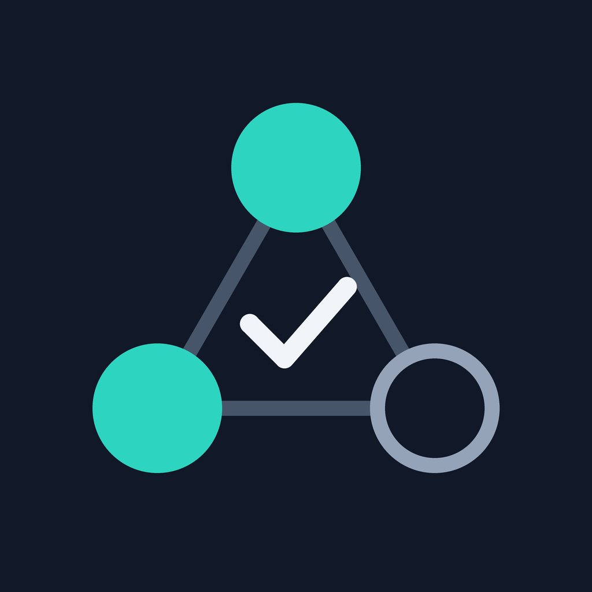
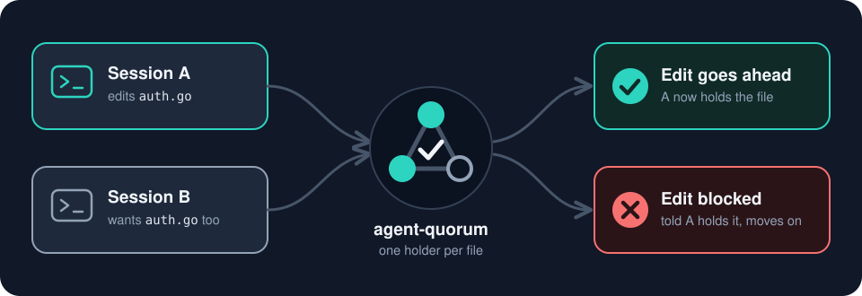
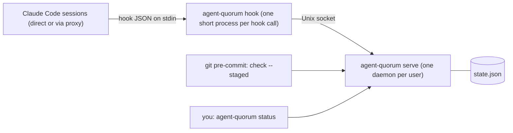
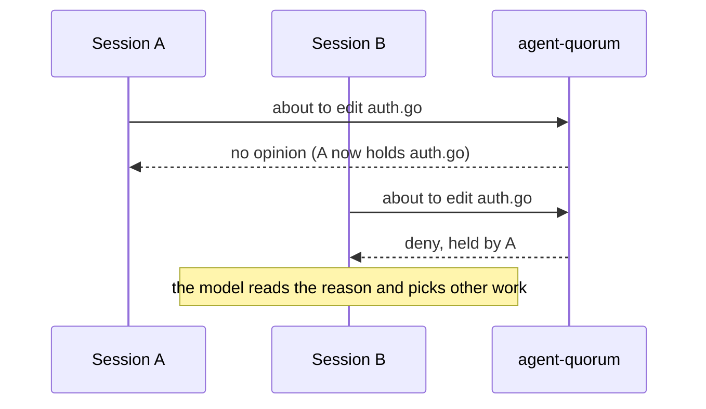
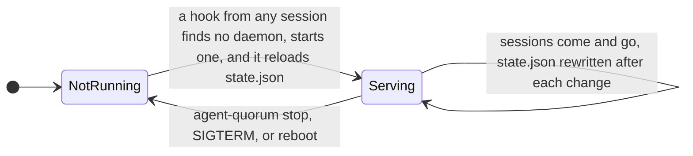
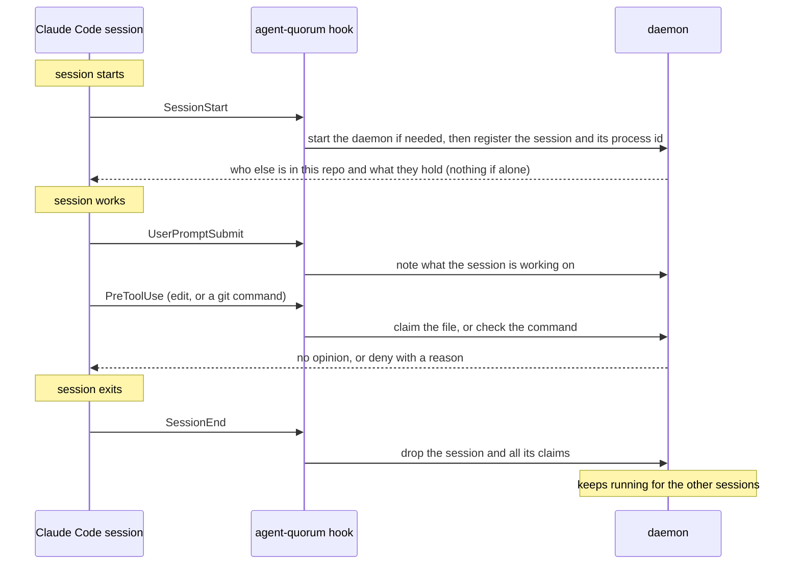

<p align="center">
  
</p>

# agent-quorum

[](https://github.com/ChristopherLiew/agent-quorum/actions/workflows/ci.yml)

Local coordination for coding-agent sessions that share one working tree. When several Claude Code sessions run in the same repository, agent-quorum stops them from editing the same uncommitted file, blocks git commands that would destroy or sweep up another session's work, and tells each session who else is there. It is one Go binary plus a Claude Code plugin, runs entirely on your machine, and fails open: if it is broken or missing, your agents behave as if it were not installed.

<p align="center">
  
</p>

## Install

Requires macOS or Linux and Claude Code.

```bash
claude plugin marketplace add ChristopherLiew/agent-quorum#stable
claude plugin install agent-quorum@agent-quorum-tools
```

That is all. The plugin downloads its binary on the next session start and verifies it against the release checksums.

- **Update:** `claude plugin update agent-quorum@agent-quorum-tools`
- **Release candidates:** add the marketplace with `#latest` instead of `#stable`.
- **Terminal CLI** (optional): the binary is installed at `~/.agent-quorum/bin/agent-quorum-<version>`. Symlink it onto your `PATH` as `agent-quorum` to run commands such as `agent-quorum status` from a terminal.

<details>
<summary>Build from source</summary>

Needs Go 1.27 and `jq`.

```bash
git clone https://github.com/ChristopherLiew/agent-quorum && cd agent-quorum
make build
AGENT_QUORUM_BIN=$PWD/bin/agent-quorum claude --plugin-dir $PWD/plugin
```

</details>

## Use

There is nothing to run. Open two or more sessions in the same repository and work as usual.

| When | What happens |
|---|---|
| A session edits a file | It holds that file until it commits or reverts it, exits, or its process dies. |
| Another session edits a held file | The edit is denied. The model is told who holds the file and to pick other work. |
| A session runs `git stash`, `checkout`, `reset --hard`, `add -A`, `commit -a` or similar while another session holds files | The command is denied, with advice such as "stage only your own files by explicit path". |
| A session starts while others are active in the repo | It is told who they are and which files they hold. |

What a blocked session sees:

```text
agent-quorum: /src/app/auth.go is being edited by another agent session (claude:9f2c1a7e, active 40s ago, working on "refactor token refresh"). Do not edit this file and do not modify it through shell commands. Continue with work that does not need it, or ask the user how to proceed.
```

See who holds what, from a terminal or with `/agent-quorum:status` inside Claude Code:

```text
$ agent-quorum status
claude:9f2c1a7e  pid 4242  idle 40s  /src/app  "refactor token refresh"
    /src/app/auth.go
claude:3b80d4c2  pid 4310  idle 2m5s  /src/app  "add retry to the http client"
    (holds no files)
```

Other commands:

| Command | What it does |
|---|---|
| `agent-quorum status [--json]` | Live sessions and the files each holds. |
| `agent-quorum release --session ID --all` | Drop a session's claims (or name specific paths instead of `--all`). |
| `agent-quorum install-git-hook` | Add a `pre-commit` hook that refuses commits containing files held by another session. Works for any agent and for you. |
| `agent-quorum check --staged` | The check that hook runs. Exit 1 if a staged file is held by someone else. |
| `agent-quorum stop` | Stop the daemon. Claims are kept and reloaded on the next start. |

## Common debugging

| Symptom | What to do |
|---|---|
| Nothing is ever blocked | Run `agent-quorum status`. If it says the daemon is not running after a session has started, no binary was found: check that `~/.agent-quorum/bin/` contains a binary for the plugin version (it is downloaded at session start, so check your network), then start a new session. |
| A file is stuck as held | `agent-quorum status` to find the session, then `agent-quorum release --session <id> --all`. |
| A file is still held just after its holder committed it | Expected for 120 seconds (the grace period, see below). Wait, or release it by hand. |
| Want to see why something was denied | `~/.agent-quorum/daemon.log` records every deny with the session and reason. |
| Want to see whether hooks ran | Start with `claude --debug-file /tmp/cc.log` and search for lines starting `Hooks:`. After editing `hooks.json`, run `/reload-plugins`. |
| Want to test a hook by hand | `./bin/agent-quorum hook --agent claude < testdata/hooks/claude/pre_edit.json; echo $?`. A deny prints one JSON line, a grant prints nothing, and the exit status is always 0. |
| Behaviour is odd after an upgrade | `agent-quorum stop`. The old daemon keeps running until stopped; the next hook starts the new one. |

## How it works



The plugin registers hooks on `SessionStart`, `PreToolUse` (edit tools, and Bash commands starting with `git`), `UserPromptSubmit` and `SessionEnd`. Each hook call runs the binary, which asks the daemon over a Unix socket in `~/.agent-quorum` and prints a decision. The first hook that finds no daemon starts one.



A grant is silent, so Claude Code's own permission prompts still apply. agent-quorum never auto-approves anything.

### Daemon lifecycle

There is nothing to start or stop by hand. One daemon per user serves every session on the machine, whichever agent or API endpoint it uses.





| Event | What the daemon does |
|---|---|
| First session of the day starts | The `SessionStart` hook finds no socket and starts the daemon, detached, logging to `daemon.log`. If several sessions start at once, a file lock lets exactly one daemon win. |
| A session exits normally | `SessionEnd` drops the session and its claims at once. |
| A session crashes or its terminal is killed | No hook fires. The next time anyone contends for its files or asks for status, the daemon sees the process is gone and drops its claims. |
| The last session exits | The daemon stays up, idle, holding no claims. It uses no CPU while idle and there is no idle timeout. |
| `agent-quorum stop`, or the daemon is killed | Sessions keep working (hooks fail open). The next hook starts a new daemon, which reloads sessions and claims from `state.json`. |
| Reboot | The daemon is gone and the old sessions' processes are dead, so their saved claims are dropped the first time they are checked. |
| Plugin upgrade | The old daemon keeps serving until you run `agent-quorum stop`; the next hook then starts the new version. |

**When a file is released.** A claim is taken by the first edit and is valid while:

```text
the holder's process is alive
AND ( the file is not in a git repository
      OR the file has uncommitted changes
      OR the claim was touched less than 120 s ago )
```

So a file frees up when the holder exits, crashes, or commits or reverts it. The 120 second grace period covers the gap between the claim (taken before the write) and the write itself, which may sit behind a permission prompt. An idle session keeps its files for as long as they are uncommitted. Claims are checked only when someone contends for the file or asks for status.

**What the git guard blocks**, and only while another live session holds files in the same repository:

| Class | Commands |
|---|---|
| Rewrites the tree | `checkout`, `switch`, `restore`, `reset --hard/--merge/--keep`, `stash`, `clean`, `rebase`, `merge`, `pull`, `cherry-pick`, `revert`, `am` |
| Sweeps the index | `add -A`, `add -u`, `add .`, `commit -a`, `commit -am` |
| Always allowed | `checkout -b`, `switch -c`, `restore --staged`, `stash list/show`, `clean -n`, `add <paths>`, plain `commit`, and everything else |

## Configuration

| Variable | Meaning |
|---|---|
| `AGENT_QUORUM_HOME` | Runtime directory (socket, `state.json`, `daemon.log`, installed binaries). Default `~/.agent-quorum`. |
| `AGENT_QUORUM_BIN` | Binary for the plugin to run. Takes precedence over the installed one. |
| `AGENT_QUORUM_NO_NOTES=1` | Do not record prompt notes (see Privacy). |
| `AGENT_QUORUM_SESSION` | Session id that `release` and `check` act as. |

**Privacy.** The first 80 characters of each prompt are stored locally in `state.json` as the session's note and shown to other sessions in the same repository, so they can see what each one is working on. Nothing leaves your machine. Set `AGENT_QUORUM_NO_NOTES=1` to turn it off.

## Agent support

| Setup | Support |
|---|---|
| Claude Code, direct or through a proxy or LLM gateway | Supported. |
| Claude Code with a separate `CLAUDE_CONFIG_DIR` | Supported; install the plugin in each config directory. |
| Codex | Planned. |
| Any other agent, and humans | The `pre-commit` hook only: it blocks the commit, not the write. |

## Limitations

- It coordinates cooperating agents. It is not a security boundary.
- Shell writes (`sed -i`, redirection, formatters) are not intercepted. The deny text tells the model not to use them, and the pre-commit hook catches the result.
- Git-ignored files are held only for the 120 second grace period.
- Edits you make in an editor are not seen.
- One machine, one user. Exact files only, no directory claims. Windows is not supported.
- Because it fails open, a broken install is silent. Check `agent-quorum status` when in doubt.

## Roadmap

A Codex adapter, detection of shell edits that bypassed a claim, notes between sessions over MCP, and a visual pane.

## Contributing

See [CONTRIBUTING.md](CONTRIBUTING.md) for the dev loop, code style, versioning policy and release checklist.

## License

[MIT](LICENSE).
