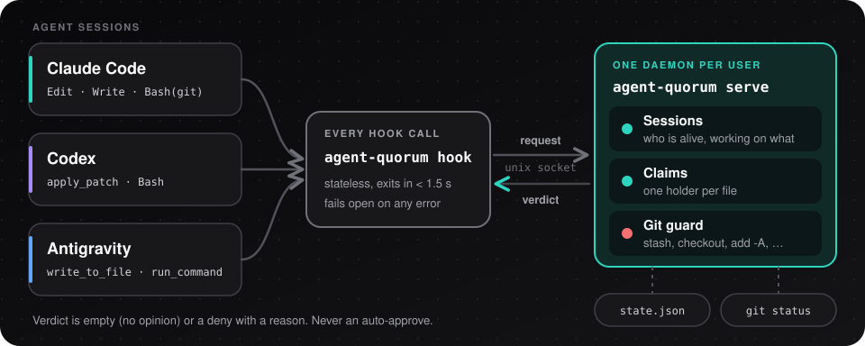
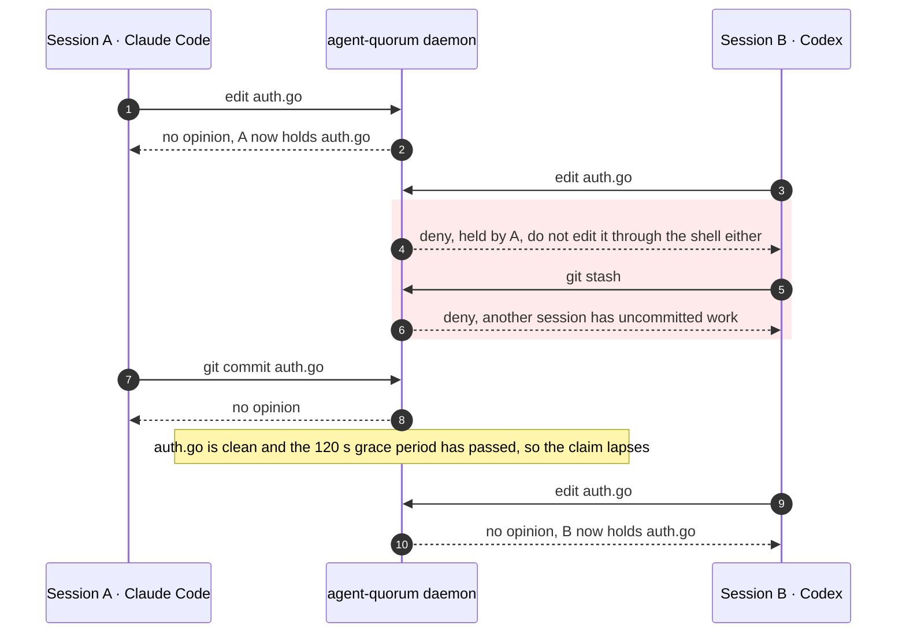

<p align="center">
  
</p>

<h1 align="center">agent-quorum</h1>

<p align="center">
  <b>Run several coding agents in one working tree without them overwriting each other.</b><br>
  A plugin for Claude Code, Codex, Antigravity and OpenCode. Local, zero-config, fails open.
</p>

<p align="center">
  <a href="https://github.com/ChristopherLiew/agent-quorum/actions/workflows/ci.yml"></a>
  <a href="https://github.com/ChristopherLiew/agent-quorum/releases"></a>
  
  <a href="go.mod"></a>
  <a href="LICENSE"></a>
</p>

<p align="center">
  <a href="#install">Install</a> ·
  <a href="#use">Use</a> ·
  <a href="#how-it-works">How it works</a> ·
  <a href="#safety-and-privacy">Safety</a> ·
  <a href="#troubleshooting">Troubleshooting</a> ·
  <a href="CONTRIBUTING.md">Contributing</a>
</p>

<p align="center">
  
</p>

## Why

Running two or three agent sessions in the same checkout is fast until one of them rewrites a file the other is halfway through, or runs `git stash` and sweeps away work that was never its own. Git worktrees avoid this but cost you a checkout per agent, separate builds and a merge at the end. agent-quorum keeps the single working tree and adds the missing coordination:

| Problem | What agent-quorum does |
|---|---|
| Two sessions edit the same file | The first session to edit a file holds it. Another session's edit is denied, and it is told who holds the file. |
| One session runs `git stash`, `checkout` or `reset --hard` over another's work | The command is denied while another session has uncommitted files in the repo. |
| One session runs `git add -A` or `commit -a` and commits another's half-finished edits | Denied, with the advice to stage its own files by path. |
| Sessions do not know about each other | Each new session is told who else is working in the repo and on which files. |

A file is released when its holder commits or reverts it, exits, or crashes. There is nothing to configure and nothing to run.

What a blocked session sees:

```text
agent-quorum: /src/app/auth.go is being edited by another agent session (claude:9f2c1a7e, active 40s ago, working on "refactor token refresh"). Do not edit this file and do not modify it through shell commands. Continue with work that does not need it, or ask the user how to proceed.
```

The message is written for the model: it says who holds the file, rules out shell workarounds, and gives the agent something else to do.

## Supported agents

Sessions from different agents coordinate with each other: a Codex session is blocked from a file a Claude Code session holds, and the other way round.

| | Claude Code | Codex | Antigravity | OpenCode |
|---|:---:|:---:|:---:|:---:|
| **File claims** | `Edit` `Write` `MultiEdit` `NotebookEdit` | `apply_patch` | `write_to_file` `replace_file_content` `multi_replace_file_content` `apply_patch` | `edit` `write` `patch` (the `edit` permission) |
| **Git guard** | `Bash` (git commands) | `Bash` | `run_command` | `shell` permission |
| **Told who else is here** | at session start | at session start | at session start and on every prompt | at the first prompt |
| **Session ends on** | `SessionEnd` | `SessionEnd` | `Stop` (the next prompt registers again) | process exit (`--standalone`) or 30 min idle (shared service) |
| **Status in-agent** | `/agent-quorum:status` | terminal CLI | terminal CLI | terminal CLI |
| **Install from** | marketplace | marketplace | local checkout | local checkout |

## Install

> [!NOTE]
> Requires **macOS or Linux**. The plugin is shell scripts only. On the next session start it downloads the matching `agent-quorum` binary from [GitHub Releases](https://github.com/ChristopherLiew/agent-quorum/releases), verifies it against the release checksums and stores it in `~/.agent-quorum/bin/`.

<details open>
<summary><b>Claude Code</b></summary>

&nbsp;

```bash
claude plugin marketplace add ChristopherLiew/agent-quorum#stable
claude plugin install agent-quorum@agent-quorum-tools
```

Start a new session, then run `/agent-quorum:status` to check it is working.

| Task | Command |
|---|---|
| Update | `claude plugin update agent-quorum@agent-quorum-tools` |
| Uninstall | `claude plugin uninstall agent-quorum@agent-quorum-tools` |

Third-party marketplaces do not auto-update by default. Turn it on under `/plugin`, or run the update command.

</details>

<details>
<summary><b>Codex</b></summary>

&nbsp;

```bash
codex plugin marketplace add ChristopherLiew/agent-quorum --ref stable
codex plugin add agent-quorum@agent-quorum-tools
```

Codex loads the hooks from the plugin's Codex manifest. **Review and trust the bundled hooks in Codex** before they run, then start a new session.

| Task | Command |
|---|---|
| Update | `codex plugin marketplace upgrade agent-quorum-tools` |
| Uninstall | `codex plugin remove agent-quorum@agent-quorum-tools` |

</details>

<details>
<summary><b>Antigravity</b></summary>

&nbsp;

Antigravity installs the plugin from a local directory, so clone the `stable` branch first:

```bash
git clone --branch stable https://github.com/ChristopherLiew/agent-quorum.git
agy plugin install ./agent-quorum/plugin
```

Enable the plugin in Antigravity if the CLI leaves it disabled.

To update, reset the checkout to the new `stable` (the channel branch is force-moved on each release, so do not `git pull`), then install again:

```bash
git -C agent-quorum fetch origin stable
git -C agent-quorum reset --hard origin/stable
agy plugin install ./agent-quorum/plugin
```

</details>

<details>
<summary><b>OpenCode</b></summary>

&nbsp;

OpenCode loads the plugin from a local checkout. It is one TypeScript file that OpenCode runs directly, with no build step and no dependencies:

```bash
git clone --branch stable https://github.com/ChristopherLiew/agent-quorum.git
```

Then add the plugin **directory** to `~/.config/opencode/opencode.json` (or a project's `opencode.json`), using the absolute path of your checkout. OpenCode rejects a path to the `.ts` file itself:

```jsonc
{
  "$schema": "https://opencode.ai/config.json",
  "plugins": ["/absolute/path/to/agent-quorum/plugin/opencode"]
}
```

On first load the plugin downloads the matching binary in the background, so coordination starts with the next session.

| Task | Command |
|---|---|
| Update | `git -C agent-quorum fetch origin stable && git -C agent-quorum reset --hard origin/stable` |
| Uninstall | Remove the entry from `plugins` |

By default OpenCode runs plugins in one shared background service that outlives your sessions, so agent-quorum cannot tell when an OpenCode session exits. Its files are released after 30 minutes without a prompt, edit or git command, or 120 seconds after they are committed or reverted. Runs started with `opencode run --standalone` are tracked by process and release immediately on exit.

</details>

<details>
<summary><b>Release candidates</b></summary>

&nbsp;

Pre-releases are published to the `latest` channel. Use it in place of `stable` when you add the marketplace:

```bash
claude plugin marketplace add ChristopherLiew/agent-quorum#latest
codex plugin marketplace add ChristopherLiew/agent-quorum --ref latest
```

</details>

<details>
<summary><b>Terminal CLI and full removal</b></summary>

&nbsp;

The CLI is optional. The binary the plugin downloaded is at `~/.agent-quorum/bin/agent-quorum-<version>`. To use it from a terminal, link it onto your `PATH`, and link it again after each update:

```bash
ln -sf ~/.agent-quorum/bin/agent-quorum-<version> ~/.local/bin/agent-quorum
```

To remove everything after uninstalling the plugin, stop the daemon and delete its state and any link you made:

```bash
~/.agent-quorum/bin/agent-quorum-<version> stop
rm -rf ~/.agent-quorum ~/.local/bin/agent-quorum
```

If you installed the git hook, also delete `.git/hooks/pre-commit` in that repository.

</details>

## Use

Open two or more sessions in the same repository and work as usual. agent-quorum stays silent until there is a conflict.

To see who holds what, run `/agent-quorum:status` in Claude Code, or this from a terminal:

```console
$ agent-quorum status
claude:9f2c1a7e  pid 4242  idle 40s  /src/app  "refactor token refresh"
    /src/app/auth.go
codex:3b80d4c2   pid 4310  idle 2m5s  /src/app  "add retry to the http client"
    (holds no files)
```

| Command | What it does |
|---|---|
| `agent-quorum status [--json]` | Live sessions and the files each holds. |
| `agent-quorum release --session ID --all` | Drop a session's claims. |
| `agent-quorum install-git-hook` | Add a `pre-commit` hook that refuses commits containing files held by another session. The hook needs `agent-quorum` on your `PATH` and does nothing without it. |
| `agent-quorum stop` | Stop the daemon. Claims are kept and reloaded on the next start. |

> [!TIP]
> Tell your agents to stage files by explicit path (`git add src/auth.go`) and to avoid `git add -A`, `commit -a`, `stash` and `checkout`. agent-quorum enforces this, but agents that already work this way are blocked less often.

## How it works

<p align="center">
  
</p>

Each agent's native hooks run a short-lived `agent-quorum hook` process before an edit or a git command. OpenCode, whose plugins must be JavaScript or TypeScript, gets a thin shim that forwards its hook events to the same process. That process asks a small local daemon, shared by every session on your machine, whether the action is safe. The daemon starts by itself on the first hook and keeps its state in `~/.agent-quorum`.

A typical contention, end to end:



- **Holding a file.** The first edit takes a claim. It lasts while the holder's process is alive and the file has uncommitted changes, plus a 120 second grace period after the last edit.
- **Crashes.** If a session dies without exiting cleanly, its files free up the next time anyone asks for them. There are no timers or background reapers.
- **Daemon restarts.** If the daemon stops, the next hook starts a new one and reloads the saved claims.

## Safety and privacy

- **Fails open.** If agent-quorum is broken, slow or missing, your agents behave as if it were not installed.
- **Never auto-approves.** A hook either has no opinion or denies. Each agent's own permission prompts still apply.
- **Local only.** One Unix socket and one state directory. Nothing leaves your machine.
- **Prompt notes.** The first 80 characters of each prompt are stored locally so sessions can see what the others are working on. Set `AGENT_QUORUM_NO_NOTES=1` to turn this off.

### Limits

agent-quorum coordinates cooperating agents and is not a security boundary.

- Shell writes such as `sed -i` or `>` redirection are not intercepted, and file claims cover only the tools in the [table above](#supported-agents).
- An OpenCode session in the shared background service holds its files for at most 30 minutes after its last prompt, edit or git command, because the service outlives the session. Other shell commands, such as a long test run, do not count as activity.
- Edits you make in your own editor are not seen.
- It works on one machine for one user.
- If every agent already has its own git worktree or clone, you do not need it.

## Troubleshooting

| Symptom | What to do |
|---|---|
| Nothing is ever blocked | Run `agent-quorum status`. If the daemon is not running after a session has started, check that `~/.agent-quorum/bin/` contains a binary (it is downloaded at session start), then start a new session. |
| A file is stuck as held | Find the session with `agent-quorum status`, then `agent-quorum release --session <id> --all`. |
| A file is still held just after it was committed | Expected for 120 seconds. Wait, or release it by hand. |
| Why was something denied? | `~/.agent-quorum/daemon.log` records every deny with the session and reason. |
| Did the hooks run? (Claude Code) | Start with `claude --debug-file /tmp/cc.log` and search for lines starting `Hooks:`. |
| Did the hooks run? (OpenCode) | Run `AGENT_QUORUM_CAPTURE=/tmp/aq.jsonl opencode run --standalone "..."`; every event the plugin forwards is appended to that file. A shared background service only sees variables it was started with. |
| Odd behaviour after an upgrade | `agent-quorum stop`. The next hook starts the new version. |

Still stuck? [Open an issue](https://github.com/ChristopherLiew/agent-quorum/issues) with your OS, agent and version, and the relevant lines from `daemon.log`.

## Contributing

Bug reports and pull requests are welcome. [CONTRIBUTING.md](CONTRIBUTING.md) covers building from source, code style, versioning, CI/CD and the release checklist.

```bash
git clone https://github.com/ChristopherLiew/agent-quorum && cd agent-quorum
make check   # vet, lint, tests
make dev     # Claude Code with the local plugin and binary
```

## License

[MIT](LICENSE)
