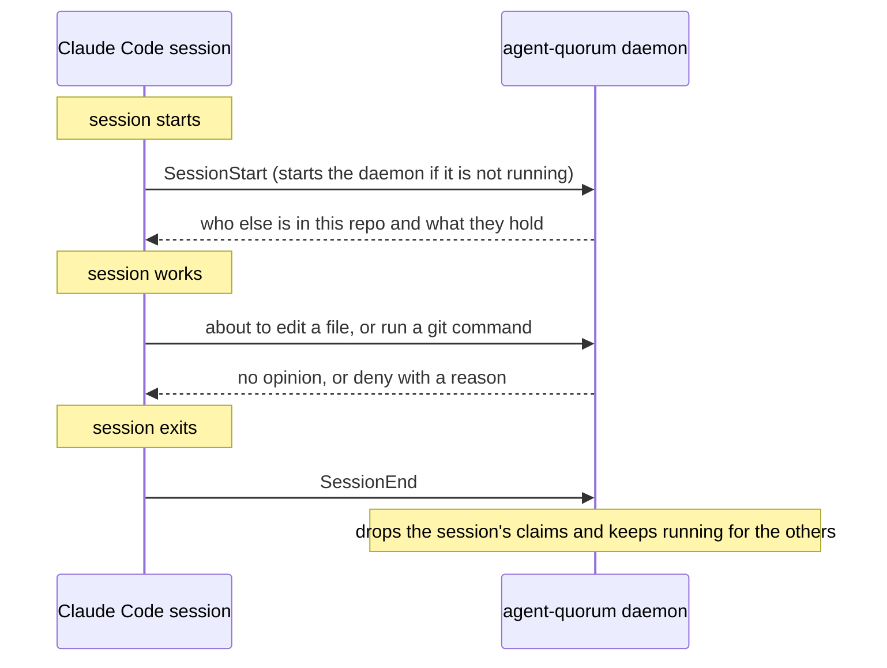

<p align="center">
  
</p>

# agent-quorum

[](https://github.com/ChristopherLiew/agent-quorum/actions/workflows/ci.yml)

A Claude Code and Codex plugin that lets several agent sessions work in the same repository at once without overwriting each other.

<p align="center">
  
</p>

## What it does

| Problem | What agent-quorum does |
|---|---|
| Two sessions edit the same file | The first session to edit a file holds it. Another session's edit is denied, and it is told who holds the file. |
| One session runs `git stash`, `checkout` or `reset --hard` over another's work | The command is denied while another session has uncommitted files in the repo. |
| One session runs `git add -A` or `commit -a` and commits another's half-finished edits | Denied, with the advice to stage its own files by path. |
| Sessions do not know about each other | Each new session is told who else is working in the repo and on which files. |

A file is released when its holder commits or reverts it, exits, or crashes. There is nothing to configure and nothing to run.

What a blocked session sees:

```text
agent-quorum: /src/app/auth.go is being edited by another agent session (claude:9f2c1a7e, active 40s ago, working on "refactor token refresh"). Do not edit this file and do not modify it through shell commands. Continue with work that does not need it, or ask the user how to proceed.
```

## Install

Requires macOS or Linux and Claude Code or Codex.

```bash
claude plugin marketplace add ChristopherLiew/agent-quorum#stable
claude plugin install agent-quorum@agent-quorum-tools
```

For Codex, add the stable marketplace and install the plugin:

```bash
codex plugin marketplace add ChristopherLiew/agent-quorum --ref stable
codex plugin add agent-quorum@agent-quorum-tools
```

The plugin downloads its binary on the next session start and verifies it against the release checksums. Codex loads the hooks from its compatibility manifest. Review and trust the bundled hooks in Codex before they run.

- **Update:** `claude plugin update agent-quorum@agent-quorum-tools`
- **Codex update:** `codex plugin marketplace upgrade agent-quorum-tools`
- **Release candidates:** add the marketplace with `#latest` instead of `#stable`.
- **Terminal CLI** (optional): the binary is installed at `~/.agent-quorum/bin/agent-quorum-<version>`. Symlink it onto your `PATH` as `agent-quorum`.

## Use

Open two or more sessions in the same repository and work as usual. To see who holds what, run `/agent-quorum:status` inside Claude Code, or from a terminal (Codex users can run the terminal command):

```text
$ agent-quorum status
claude:9f2c1a7e  pid 4242  idle 40s  /src/app  "refactor token refresh"
    /src/app/auth.go
claude:3b80d4c2  pid 4310  idle 2m5s  /src/app  "add retry to the http client"
    (holds no files)
```

| Command | What it does |
|---|---|
| `agent-quorum status [--json]` | Live sessions and the files each holds. |
| `agent-quorum release --session ID --all` | Drop a session's claims. |
| `agent-quorum install-git-hook` | Add a `pre-commit` hook that refuses commits containing files held by another session. |
| `agent-quorum stop` | Stop the daemon. Claims are kept and reloaded on the next start. |

## How it works

The plugin adds hooks to Claude Code. Each hook call asks a small local daemon, shared by every session on your machine, whether the edit or git command is safe. The daemon starts by itself on the first hook and keeps its state in `~/.agent-quorum`.



- **Holding a file.** The first edit takes a claim. It lasts while the holder's process is alive and the file has uncommitted changes, plus a 120 second grace period after the last edit.
- **Crashes.** If a session dies without exiting cleanly, its files free up the next time anyone asks for them.
- **Daemon restarts.** If the daemon stops, the next hook starts a new one and reloads the saved claims.
- **Fails open.** If agent-quorum is broken or missing, your agents behave as if it were not installed. It never auto-approves anything, so Claude Code's own permission prompts still apply.
- **Privacy.** The first 80 characters of each prompt are stored locally so sessions can see what the others are working on. Nothing leaves your machine. Set `AGENT_QUORUM_NO_NOTES=1` to turn it off.

Limits: it coordinates cooperating agents and is not a security boundary. Shell writes such as `sed -i` are not intercepted, edits you make in an editor are not seen, and it works on one machine for one user. Codex file claims cover `apply_patch`; shell writes remain outside hook coverage.

## Debugging

| Symptom | What to do |
|---|---|
| Nothing is ever blocked | Run `agent-quorum status`. If the daemon is not running after a session has started, check that `~/.agent-quorum/bin/` contains a binary (it is downloaded at session start), then start a new session. |
| A file is stuck as held | Find the session with `agent-quorum status`, then `agent-quorum release --session <id> --all`. |
| A file is still held just after it was committed | Expected for 120 seconds. Wait, or release it by hand. |
| Why was something denied? | `~/.agent-quorum/daemon.log` records every deny with the session and reason. |
| Did the hooks run? | Start with `claude --debug-file /tmp/cc.log` and search for lines starting `Hooks:`. |
| Odd behaviour after an upgrade | `agent-quorum stop`. The next hook starts the new version. |

## Contributing

See [CONTRIBUTING.md](CONTRIBUTING.md) for building from source, code style, versioning, CI/CD and the release checklist.

```bash
git clone https://github.com/ChristopherLiew/agent-quorum && cd agent-quorum
make check   # vet, lint, tests
make dev     # Claude Code with the local plugin and binary
```

## License

[MIT](LICENSE)
